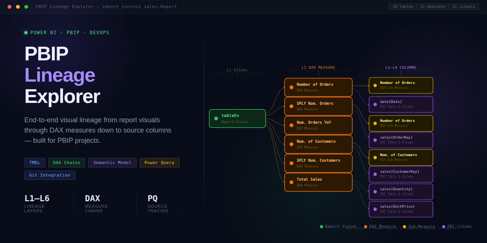

# PBIP Lineage Explorer

**Trace Power BI visuals all the way back to the original source column — before any Power Query renames — in seconds, entirely in your browser.**

> **This is a modified, customized, and enhanced fork maintained by [Abearstudios](https://github.com/Abearstudios), based on the original open-source [PBIP Lineage Explorer](https://github.com/JonathanJihwanKim/pbip-lineage-explorer) by [Jihwan Kim](https://github.com/JonathanJihwanKim). All credit for the original tool and architecture goes to Jihwan Kim — see [Credits](#credits) below.**

- 🔍 **Trace any Power BI visual → measure → column → source** in one click
- 🎯 **Measure Map** — a measure-centric view showing everything a measure depends on, everything that depends on it, and every visual it reaches
- 📁 **Multi-report workspaces** — point it at a folder with several PBIP reports sharing a semantic model and see cross-report impact in one graph
- 🔒 **100% in your browser** — files never uploaded, no account, no server
- ⚡ **Works on TMDL/PBIR** — the format Power BI Desktop now saves by default

[](LICENSE)

Free · 100% client-side · Your files never leave your browser · [MIT License](LICENSE)


*Click a visual → see the full chain from visual to source column, including Power Query renames.*

---

## What's New in This Fork

Enhancements Abearstudios added on top of the original project:

- **Measure Map** — pick any measure and see it at the center of its own map: what it depends on, what depends on it, and every visual across every page it ultimately reaches. Built for quickly scoping the blast radius of a measure change.
- **Multi-report workspace support** — open a folder containing several `.Report`/`.SemanticModel` pairs (e.g. multiple Power BI reports saved into one folder sharing a semantic model) and get one combined lineage graph. Impact analysis, orphan detection, and the Measure Map all consider every report at once, labeled by report and page.
- **Filter-aware orphan detection** — a measure that's only referenced by a report/page/visual filter pane is no longer flagged as an orphan if that filter is actively set to a non-default value (i.e., it's really filtering something). Measures sitting in an inactive/default filter still count as orphans.
- **Overlap-free lineage trees** — the D3 lineage diagram now runs a post-layout collision pass so nodes never overlap, even in dense trees.

## Quick Start

**The easy way — no commands needed:**

1. Download or clone this repo
2. Double-click **`start.bat`** (Windows) or **`start.command`** (macOS)
3. Your browser opens automatically at `http://localhost:5173`

The first run installs dependencies and takes a few minutes; every run after that is instant. You need [Node.js](https://nodejs.org) installed once — the launcher tells you if it's missing.

**Or from a terminal:**

```bash
npm install
npm run dev
```

**Then:**

1. Click **Open Project Folder** and select your PBIP project root (the folder containing `.SemanticModel` and `.Report` subfolders — or any parent folder; nested projects are found automatically)
2. Click any **visual** in the left panel → see every measure, column, and source it uses
3. Click any **measure** → trace its full DAX dependency chain to source, or open **Measure Map** to see its full blast radius

> Requires **Chrome 86+** or **Edge 86+** ([File System Access API](https://developer.mozilla.org/en-US/docs/Web/API/File_System_API)). Firefox and Safari are not supported.

> Everything runs locally. The server only serves the page to your own browser — your PBIP files are read in the browser and never leave your machine.

### Data Engineer Quick Start

1. Open your PBIP project folder
2. Click **Visuals** tab in the left panel → click any chart or table visual
3. The **Source Columns — All Measures** section loads immediately, showing every source table/column
4. Click **Grouped by Source** to group by source database/table — see which datasets, SQL schemas, or files feed this visual
5. For the full model mapping: click **Source Map** in the toolbar → search, sort, and export as CSV

### Power BI Developer Quick Start

1. Open your PBIP project folder
2. Click **Measures** tab → click any measure
3. See the interactive tree (Visual → Measure → Table → Column → Source), or click **Measure Map** for a measure-centered view of everything it touches
4. Click **↗ Impact** next to any measure → see every downstream visual and upstream dependency
5. Click **Source-First View** toggle to see source columns before DAX (great for reviewing with data engineers)

---

## The Problem

### For data engineers working with Power BI developers

- A Power BI developer gives you a dashboard. You need to know: **"What tables and columns feed this visual?"** You trace through dozens of TMDL files by hand.
- You see a column called `customer_id` in the Power BI model. The source column is actually `cust_fk`. **No tool shows you this rename chain** without opening every Power Query step manually.
- A data engineer asks: **"Which source tables are used in this dashboard?"** The Power BI developer has to dig through the semantic model and piece it together from memory.
- You need to validate that a source column rename won't silently break a report. **There's no way to check without deploying and hoping.**
- Someone modifies a shared DAX measure — **you don't know which visuals are impacted downstream, or across how many reports.**

**Each of these takes hours. This tool does it in seconds.**

| | Manual | PBIP Lineage Explorer |
|---|---|---|
| "What source tables feed this visual?" | Trace through dozens of TMDL files | **One click → Source Columns section** |
| Source column before Power Query renames | Open each PQ step manually | **Full rename chain: source → PQ → PBI** |
| Visual → measure → source column chain | Copy-paste across dozens of files | **Interactive tree: Visual → Table → Column → Source** |
| "What does changing this measure affect?" | Not feasible at scale | **Measure Map — one view, every dependency and visual** |
| Impact across multiple reports on one model | Open each report separately | **Multi-report workspace — one combined graph** |
| What changed in the last 5 commits? | Diff raw JSON by hand | **Automatic change report with 30+ change types** |

---

## Who Is This For?

### Data Engineers & Power BI Developers working together

This tool directly bridges the gap between the two teams:

**Data engineers get:**
- A "Source Columns" section right at the top of every visual — showing every source table and column that feeds it, with full rename chains (source name → Power Query name → Power BI name)
- A flat **Source Map** table (toolbar button) listing every PBI column mapped to its original source column, database, and schema — exportable as CSV
- **Group by Source** view to see all columns from a given dataset, SQL schema, or file source in one block
- "Source-First View" toggle to see source column mapping before the DAX chain

**Power BI developers get:**
- DAX dependency tree — interactive D3 graph showing every referenced measure and column with syntax-highlighted DAX
- **Measure Map** — a hub-and-spoke view centered on one measure, showing what it depends on, what depends on it, and every visual/page it reaches
- Calculation group lineage — see all calculation items (YTD, QTD, MTD) with their DAX expressions
- Field parameter resolution — see ALL measures a field parameter contains, not just the active one
- Impact analysis — select any measure to instantly see what breaks if you change it
- Filter-aware orphan detection — measures actively used only via a report/page/visual filter aren't mislabeled as orphans
- Commit-by-commit change detection with downstream impact tracing

**Team Leads & Governance:**
- Multi-report workspace mode — see cross-report impact of a shared semantic model in one place
- Track changes across commits (measures, columns, relationships, source expressions)
- Export lineage as CSV/Markdown for documentation
- Run impact analysis before approving PRs
- Model Health Dashboard — tables, columns, measures, relationships, data sources at a glance

---

## What You Get

### For Everyone

- **Visual-to-source lineage in one click** — full chain from report visual to original source column, through any number of DAX measures and sub-measures
- **Measure Map** — measure-centered map of dependencies, dependents, and every reachable visual/page
- **Multi-report workspace** — analyze several PBIP reports sharing a semantic model as one combined graph
- **Interactive D3 tree** — Visual → Measure → Table → Column → Power Query → Source, with click-to-expand nodes and automatic overlap-free layout
- **Measure view / Source view tree toggle** — flip the D3 tree direction: horizontal (measure-centered) or vertical top-down (source → Power Query → table → columns → measure → visuals) for upstream tracing
- **Discoverable zoom controls** — on-canvas +/−/Fit/1× buttons plus scroll-to-zoom and drag-to-pan, with extended zoom range for large trees
- **Export** — SVG, PNG, CSV, Markdown — or copy lineage to clipboard

### For Data Engineers

- **Source Columns section** — appears at the top of every visual's lineage, listing every source table and column that feeds it
- **Full rename chain tracking** — when a source column is renamed in Power Query, you see `source_name → pq_name → pbi_name` at every level
- **Group by Source** toggle — view aggregated source columns grouped by source database/table instead of a flat list
- **Source-First View** — swap section order so source mapping appears before the DAX chain
- **Source Map view** — flat, searchable, sortable table mapping every PBI column to its source. Filterable by source type. Exportable as CSV
- **Source node display** — in the tree, source nodes show the source type, server, database, schema, and table name
- **Column rename indicators** — column nodes show `← src: original_name` in amber when a rename happened

### For Power BI Developers

- **DAX dependency tree** — recursive tree of measure dependencies with syntax-highlighted DAX, Copy buttons, and USERELATIONSHIP display
- **Measure Map** — see a measure at the center of its own web of relationships, including every visual it reaches even indirectly (field parameters, calculation groups)
- **Calculation group lineage** — see all calculation items (YTD, QTD, MTD) with their full DAX expressions
- **Field parameter resolution** — see ALL measures a field parameter contains, not just the active one
- **Impact analysis** — click ↗ Impact on any measure to see upstream and downstream dependencies grouped by type
- **Filter-aware orphan detection** — measures only used via an actively-set report/page/visual filter aren't flagged as orphans
- **Page layout minimap** — see every visual positioned as in Power BI, click to trace lineage
- **Model Health Dashboard** — tables, columns, measures, relationships, data sources at a glance

### Change Intelligence

- **Commit-by-commit change detection** — see exactly what changed, when, and who is impacted
- **30+ change types across 8 scopes** — pages, visuals, filters, measures, bookmarks, columns, relationships, and source expressions
- **Downstream impact tracing** — when a measure changes, see every visual affected through direct refs, field parameters, and calculation groups
- **Human-readable descriptions** — no raw JSON diffs, just plain-language summaries
- **Works in browser and VS Code** — same detection engine, both platforms

> Your files never leave your browser. All parsing happens client-side — nothing is uploaded anywhere.

---

## Why This Tool?

Enterprise platforms like Microsoft Purview, Alation, and Blindata are excellent for organization-wide data governance. Tools like Measure Killer and Power BI Sentinel solve specific problems well within their scope.

This tool fills a different gap: **instant, client-side, column-level lineage for PBIP projects** — no server, no license, no setup. It's designed for the developer or data engineer who needs an answer *right now*.

| What makes this tool different | |
|---|---|
| **Column-level lineage with renames** | Trace from visual all the way to the original source column — including Power Query rename chains |
| **Measure-centric impact view** | Measure Map shows a measure's full blast radius — dependencies, dependents, and every visual it reaches |
| **Multi-report awareness** | Analyze several PBIP reports sharing a semantic model as one graph, not one at a time |
| **Visual → Table → Column → Source** | The tree shows Table and Power Query nodes, completing the full chain |
| **Source grouping by database/table** | View all source columns grouped by their origin — ideal for data engineers reviewing dashboards |
| **Field parameter resolution** | See ALL measures a field parameter contains, not just the active one |
| **Calculation group lineage** | See every calculation item with its DAX expression |
| **100% client-side** | Your files never leave your browser — no upload, no server, no account |
| **PBIP native** | Built for TMDL/PBIR from the ground up — the file formats [Power BI Desktop now uses by default](https://learn.microsoft.com/en-us/power-bi/developer/projects/projects-overview) |
| **Open-source** | MIT licensed |

---

## FAQ

**Is my data really safe?**
Yes. Nothing leaves your browser. All parsing happens locally in JavaScript. The full source code is MIT-licensed and auditable.

**Do I need to install anything?**
You need Node.js to run it locally (`npm install && npm run dev`), then it runs in Chrome 86+ or Edge 86+. A VS Code extension is also available if you prefer to work inside your editor.

**What if my PBIP uses calculation groups, field parameters, or custom connectors?**
All supported. Calculation group lineage, field parameter resolution, and source column tracing are built into the core engine.

**Can I use this at work on proprietary reports?**
Yes. MIT license — use it freely. No telemetry, no network requests, no account. Your files never leave the browser.

**How is this different from the original PBIP Lineage Explorer?**
This fork adds a measure-centric Measure Map, multi-report/multi-model workspace support, filter-aware orphan detection, and an overlap-free lineage tree layout. See [What's New in This Fork](#whats-new-in-this-fork) above. Everything else builds on the original engine and UI by Jihwan Kim.

---

## VS Code Extension

Also available as a VS Code extension for developers who work directly in PBIP/TMDL files.

- **Sidebar panels**: Measure Explorer, Orphan Measures, Model Stats, **Change History**
- **CodeLens**: inline "Trace Lineage" links above measure definitions
- **Change History panel**: auto-scans recent commits, shows changes grouped by commit → scope → detail with impact badges

See [`packages/vscode/README.md`](packages/vscode/README.md) for build/packaging instructions.

---

## More

- [Detailed reference guide](docs/reference.md) — UI overview, keyboard shortcuts, use cases, folder structure
- [Contributing](CONTRIBUTING.md) — development setup and PR guidelines
- [License](LICENSE) — MIT

---

## Credits

This project is a modified, customized, and enhanced version of **[PBIP Lineage Explorer](https://github.com/JonathanJihwanKim/pbip-lineage-explorer)**, originally created and maintained by **[Jihwan Kim](https://github.com/JonathanJihwanKim)**. The original project's architecture, parsing engine, and UI form the foundation this fork builds on — full credit to Jihwan Kim for the original work.

This fork is built and maintained by **Abearstudios**, adding the Measure Map, multi-report workspace support, filter-aware orphan detection, and lineage-diagram layout fixes described above.

If you're evaluating this tool, consider also checking out [the original project](https://github.com/JonathanJihwanKim/pbip-lineage-explorer) and its author's other Power BI tooling.

---

**Built for:** Power BI · Microsoft Fabric · PBIP · PBIR · TMDL · Data Lineage · DAX · Semantic Models · Impact Analysis · Data Governance · Data Engineering
